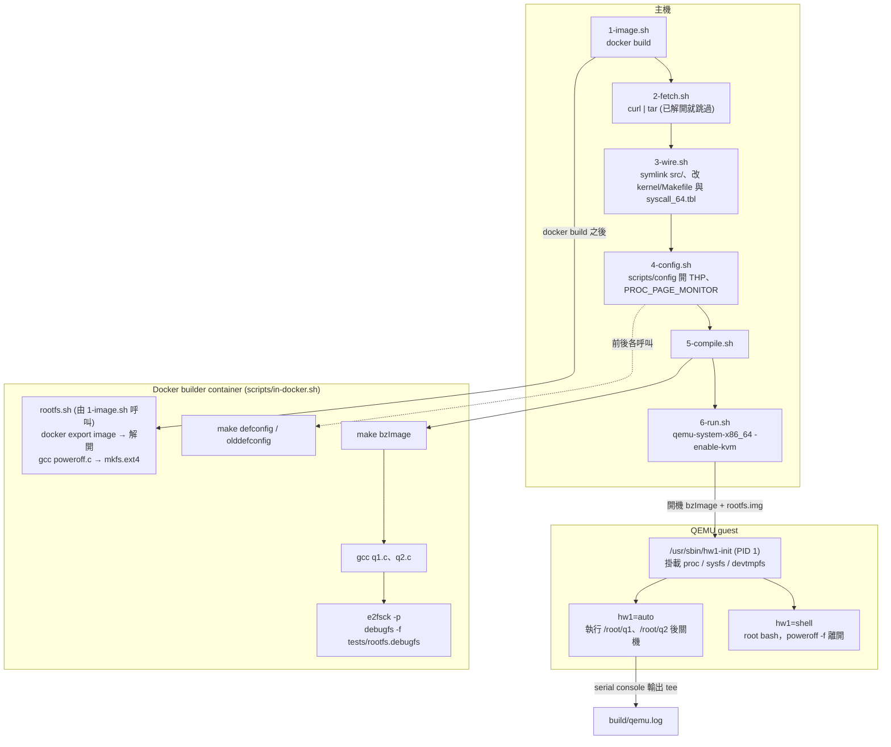
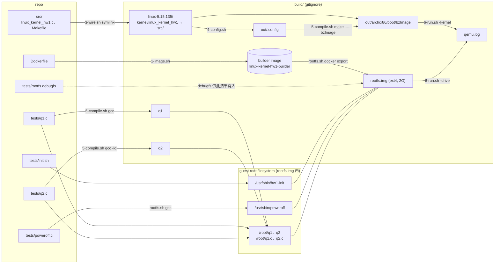

# Architecture

這個專案在 Linux 5.15.135 新增 syscall `my_get_physical_addresses` (x86_64 number 449)。整個流程分在三個環境裡執行：

- **主機**：依序執行 `scripts/` 的各個步驟，下載並修改 kernel source，最後用 QEMU 開機
- **Docker builder container** (`linux-kernel-hw1-builder`，Ubuntu 22.04 / GCC 11)：`scripts/in-docker.sh` 把 `docker run` 包起來，所有編譯和 image 處理都在這裡做
- **QEMU guest**：用 `build/rootfs.img` 當 root filesystem 開機，PID 1 是 `/usr/sbin/hw1-init` (也就是 `tests/init.sh`)，由它執行測試

環境建置的細節見 [`README.md`](../README.md)，作業引導見 [`GUIDE.md`](./GUIDE.md)。

## 1. 建置流程

- 第一次要依序執行 1 到 6；之後修改 `src/linux_kernel_hw1.c`，只需要重跑 `5-compile.sh && 6-run.sh`
- `4-config.sh` 裡的 `defconfig`、`olddefconfig` 在 container 裡執行，夾在中間的 `scripts/config` 則在主機上執行
- `1-image.sh` 在 `docker build` 之後呼叫 `rootfs.sh`，每次都重建 `build/rootfs.img`。其中 `docker create`、`docker export` 在主機上執行，解開 image、編譯 `poweroff`、`mkfs.ext4` 則在 container 裡
- `2-fetch.sh` 發現 `build/linux-5.15.135` 已存在就直接結束，避免重新解壓蓋掉 `3-wire.sh` 改過的 `kernel/Makefile` 與 `syscall_64.tbl`

## 2. 檔案與產物對應

- `rootfs.img` 是把整個 builder image 匯出後做成的 Ubuntu 22.04 root filesystem，所以 guest 裡有 bash、gcc、glibc。它由 `rootfs.sh` 建立，`1-image.sh` 每次都會呼叫它；修改 `Dockerfile` 之後重跑 `1-image.sh`，只改 `tests/poweroff.c` 時重跑 `rootfs.sh` 即可，兩者之後都要再跑 `5-compile.sh`
- 每次執行 `5-compile.sh`，都會用 `debugfs` 照 `tests/rootfs.debugfs` 的清單，把 `init.sh`、`q1`、`q2` 和它們的原始碼覆寫進 `rootfs.img`，不需要 mount，也不需要 root
- `qemu.log` 只在自動模式 (`6-run.sh` 不加參數) 產生，`shell` 模式不會寫檔
